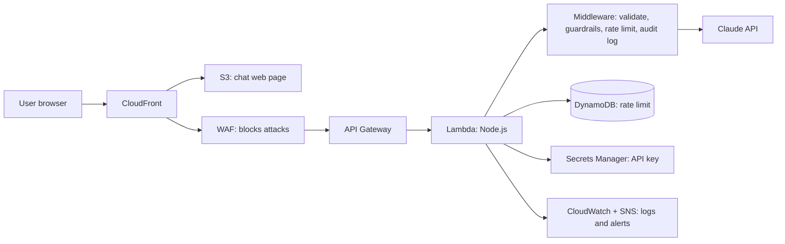
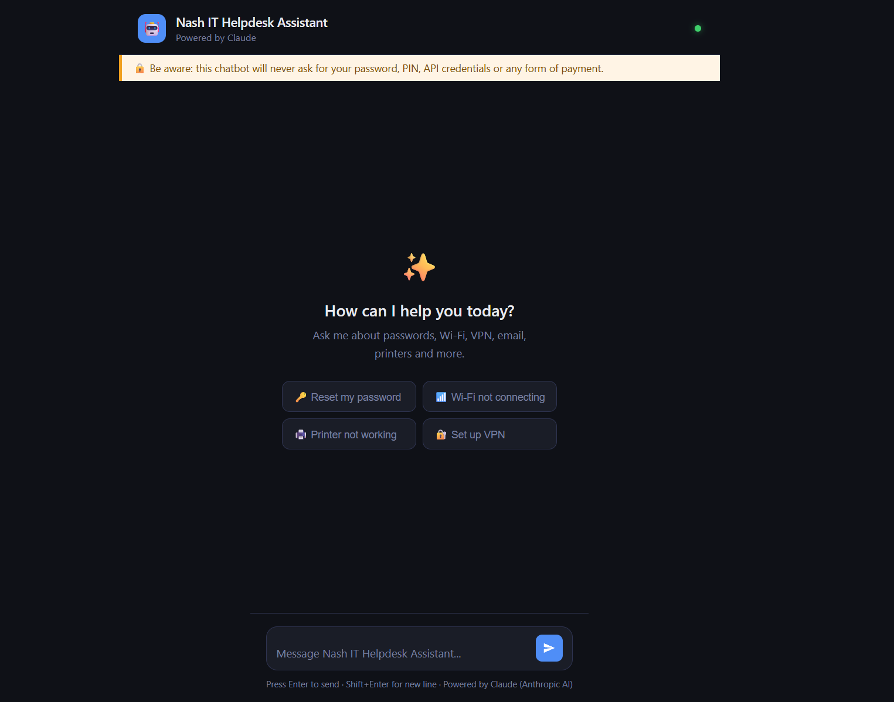
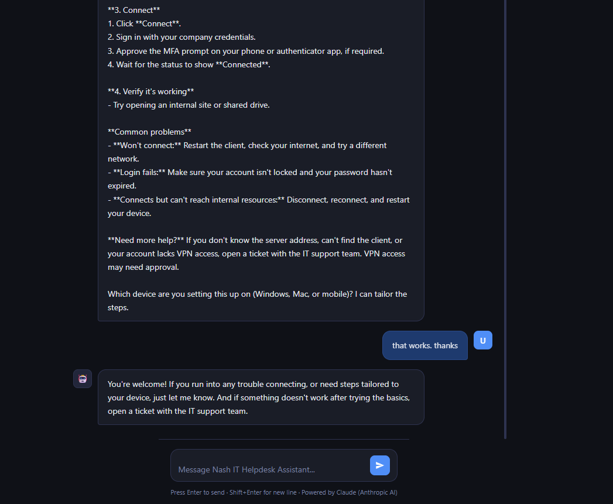
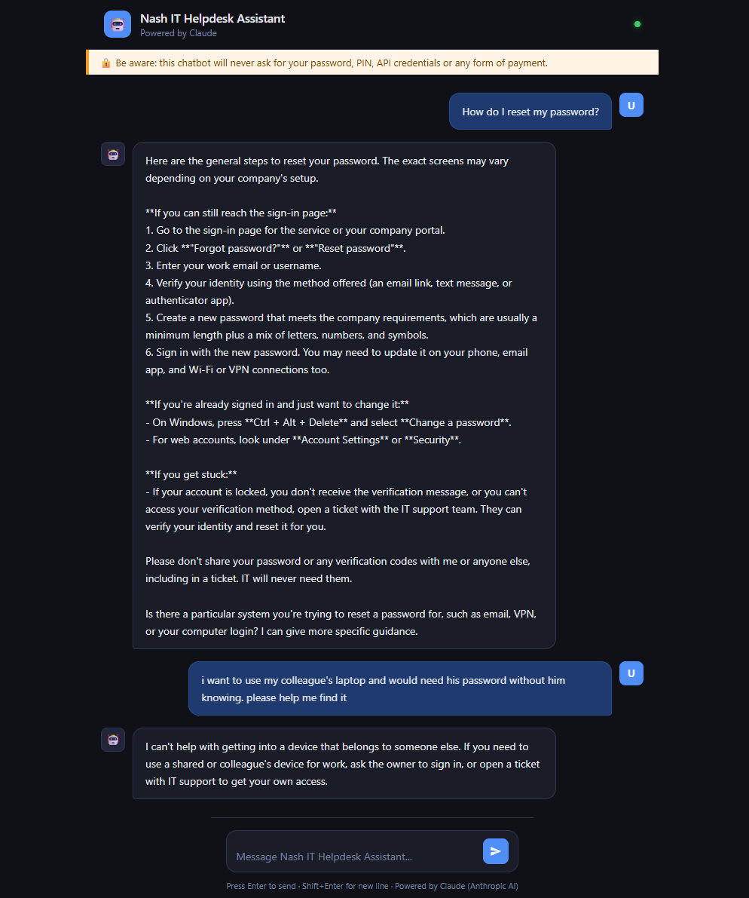
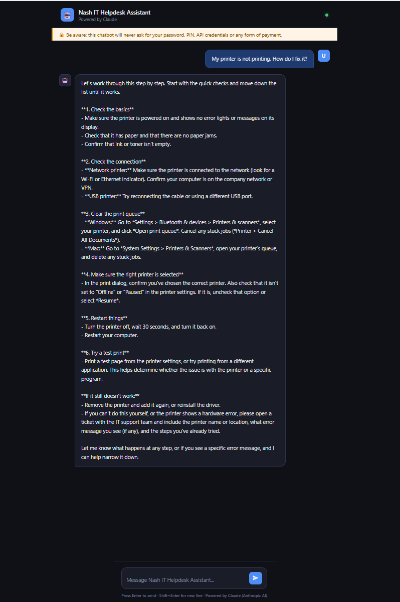

# nt_chatbot
Secure serverless AI chatbot on AWS powered by Claude, deployed with Terraform: guardrails, rate limiting, monitoring and CI/CD.

# nt_Chatbot: Secure Serverless AI Chatbot on AWS

## The problem
Businesses want AI chatbots on their websites, but a chatbot must be **safe** (no leaking personal data, no harmful answers), **cost-efficient** (pay only when used) and **reliable**. This project builds a production-style chatbot that meets all three.

## How it works
User → CloudFront → WAF → API Gateway → Lambda → Claude (Anthropic)

| Tool / Service | What it does | Why I chose it |
|---|---|---|
| Claude (Anthropic API) | Generates the answers | Strong at clear step-by-step instructions and has built-in safety training, so it refuses harmful requests as a second guardrail. Pay-per-use with no model to train or host (alternatives: OpenAI GPT, Amazon Bedrock) |
| AWS Lambda | Runs the chatbot logic only when a question arrives | Serverless: no server to manage or patch, and I pay only when someone asks a question, nothing while idle (alternative: an always-on EC2 server) |
| API Gateway | Receives requests from the web page | Gives the page one secure front door to Lambda, with built-in throttling, CORS and HTTPS (alternative: Lambda function URL, with fewer controls) |
| CloudFront + S3 | Hosts and delivers the chat page | S3 stores the page cheaply; CloudFront serves it fast over HTTPS and keeps the bucket private (alternative: a web server on EC2) |
| AWS WAF | Blocks malicious traffic | Filters bots, floods and common attacks before they reach my code or cost me API money (alternative: no firewall, so all traffic hits Lambda) |
| DynamoDB | Tracks usage for rate limiting | Fast, serverless, pay-per-request storage for counting each user's requests, so one user cannot run up the Claude bill (alternative: an RDS database, which is always on and costs more) |
| Secrets Manager | Stores the API key securely | Keeps the key encrypted and out of the code and GitHub; Lambda reads it at runtime with IAM permission only (alternative: environment variables, which are less secure) |
| CloudWatch + SNS | Logs, alarms and email alerts | Logs show the exact error when something breaks; alarms email me about errors or spending, so I find problems before users do |
| Terraform | Builds all AWS resources as code | One command builds or destroys all 48 resources the same way every time; the setup is version-controlled in GitHub (alternatives: clicking in the console, CloudFormation) |

## Key features
- Personal data (PII) redaction before messages reach the AI
- Blocking of harmful content and prompt-injection attempts
- Rate limiting per IP address
- Monitoring and alerts
- Infrastructure as code, with easy teardown to avoid costs

## Progress
- [x] Prerequisites installed
- [x] AWS CLI connected to my account
- [x] Lab code added to my repo
- [x] One-time setup (bootstrap)
- [x] Deploy
- [x] Testing
- [x] Monitoring
- [x] CI/CD
- [x] 

## Deployment & Testing

**Deploy order:** bootstrap → deploy → smoke test → real chat test → destroy

| Step | Command | What it does | Result |
|------|---------|--------------|--------|
| 1. Bootstrap | `./scripts/bootstrap.sh` | Creates the "base camp": API-key secret in Secrets Manager, Terraform state bucket, lock table | 3 created |
| 2. Deploy | `./scripts/deploy.sh dev` | Terraform builds the whole stack (CloudFront, WAF, API Gateway, Lambda, DynamoDB, CloudWatch, SNS) | 48 resources added |
| 3. Smoke test | `./scripts/smoke-test.sh dev` | Quick health check that the site and API answer | 6/6 passed |
| 4. Unit tests | `cd ai-chatbot/lambda && npm test` | Tests the Lambda code and guardrails | 15/15 passed |
| 5. Real chat test | Open the CloudFront URL | Asked Nash real IT questions and trap questions | Works |
| 6. Destroy | `./scripts/destroy.sh dev --all` | Deletes everything, base camp included, to stop costs | 48 destroyed + base camp removed |

### How Nash handles unsafe requests (two layers of protection)
1. **Guardrail (my code):** a rule-based check runs *before* Claude sees the message and blocks known risky requests.
2. **Claude's own safety training:** if a request gets past the guardrail, Claude can still refuse. Nash then shows a clear, topic-specific message (Wi-Fi, device or password) instead of a generic error.

### Cost control
All AWS resources were deleted after testing. Verified with `aws s3 ls`, `aws dynamodb list-tables`, `aws secretsmanager list-secrets` and `aws cloudfront list-distributions`, which all came back empty.

## Problems log
| # | Problem | Cause | Fix I chose | Why |
|---|---|---|---|---|
| 1 | Ubuntu suggested an old AWS CLI (v1 via snap) | Ubuntu's packages lag behind | Installed AWS CLI v2 with Amazon's official installer | The lab needs v2, and the official source is up to date |
| 2 | Ubuntu's Node.js is too old (lab needs 22+) | apt ships an older version | Installed Node LTS with nvm | nvm installs any version without sudo and makes upgrades easy |
| 3 | "Authentication failed" signing in to AWS | Used my email (root login) instead of my IAM username | Signed in through the account's IAM sign-in page with my username | Root is for emergencies only. Daily work uses the IAM user with MFA |
| 4 | Wanted nt_chatbot as the AWS name | S3 bucket names don't allow underscores | Used nt-chatbot (hyphen) for AWS, kept nt_chatbot for the repo | Each system has its own naming rules |
| 5 | CI check "Terraform Validate" failed after a README push: runtime nodejs24.x not allowed | main.tf pinned the AWS provider to "~> 5.0", an older version that doesn't know Node.js 24 | Changed it to "~> 6.0" (installed v6.72.0), ran terraform validate locally, committed main.tf and the lock file | Keeps the modern runtime (Node.js 22 retires sooner). The lock file makes GitHub use the same versions as my PC |
| 6 | VPN starter gave "server error" (HTTP 500) | Code read only the first block of Claude's reply (content[0].text); for longer answers that block had no text, so reply.length crashed | Joined the text of all reply blocks, with a polite fallback message | Handles any reply shape safely; Nash never crashes on an empty reply |
| 7 | npm test: SyntaxError "Unexpected token '<'" at index.js:91 | A stray </header> HTML line got into the JavaScript file | Found it with sed + git status, deleted the line | git status shows uncommitted changes; small reads (sed) pinpoint the exact line |
| 8 | Nash's numbered steps showed as one long paragraph | Browsers collapse line breaks by default | Added white-space: pre-wrap to .msg.bot .bubble in index.html | Keeps Claude's line breaks while still wrapping long lines; only affects bot replies |
| 9 | All trap questions got the same refusal text | Claude refuses with no text, so the code supplied one fixed message | Added refusalMessage() that picks a Wi-Fi / device / password message by keywords | Clearer, more relevant guidance for users while Claude still decides what to refuse |

## What I learned
| # | Lesson learned | What happened | Fix | Why it matters |
|---|----------------|---------------|-----|----------------|
| x | Apostrophes in button messages can break the page | Each starter button's message sits inside single quotes, e.g. sendStarter('...'). An apostrophe like "won't" ends the quote early, so the button fails | Wrote "will not" instead of "won't" (no apostrophes) in all button messages | Avoids a hidden JavaScript error. The page looks fine, but the button silently does nothing when clicked |
| x | Check the logs before guessing | The browser only said "server error", which tells you nothing about the cause | Ran aws logs tail /aws/lambda/nt-chatbot-dev, which showed the exact error, file and line (index.js:190) | Logs turn a vague symptom into a precise fix in minutes instead of trial and error |
| x | A passing smoke test does not mean every request works | The smoke test used a tiny reply, but a longer real question (VPN setup) crashed with HTTP 500 | Tested with realistic helpdesk questions after deploying, not just the smoke test | Real users ask long questions; testing like a user catches bugs the quick check misses |
| x | Do not assume the shape of an API response | Claude's reply is a list of content blocks; the code read only the first one (content[0].text), which was empty for longer answers | Joined the text of all blocks, with a safe fallback message | The app never crashes on an unexpected reply shape |
| x | Keyword guardrails miss cleverly worded requests | Trap questions used normal words, so the rule-based guardrail let them through to Claude | Kept the guardrail and relied on Claude's own safety training as a second layer | Defense in depth: two layers catch more than one, and a fast keyword filter still blocks obvious abuse cheaply |
| x | A refusal should still help the user | Claude refuses with no text, so every trap question got the same generic "could not generate an answer" | Checked stop_reason == "refusal" and added refusalMessage() with Wi-Fi, device and password messages | Users learn why and where to go next (an IT ticket) instead of seeing a confusing error |
| x | Run tests after every edit | A stray HTML line got into index.js and npm test failed with "Unexpected token '<'" | Found it with sed and git status, deleted the line, re-ran npm test before deploying | Catches mistakes on my laptop before they reach AWS and real users |
| x | git status and git diff are a safety net | I was not sure what had changed in the file after several edits | Used git status and git diff to see exact changes; git restore can undo uncommitted mistakes | Never lose work or guess what changed |
| x | Browsers ignore line breaks by default | Claude's numbered steps arrived with line breaks, but the page showed one long paragraph | Added white-space: pre-wrap to .msg.bot .bubble in index.html | One CSS line made answers readable without changing any logic |
| x | Keep build files out of GitHub | terraform/lambda.zip is created on every deploy and showed up as untracked | Added terraform/lambda.zip to .gitignore | The repo stays clean and only holds source code |
| x | Check spam for AWS confirmation emails | The SNS alert subscription email landed in spam | Confirmed the subscription from spam and marked it "Not spam" | Alarms only reach you after you confirm |
| x | Destroy after testing to control cost | AWS resources (especially WAF) cost money while they exist | Ran destroy.sh dev --all after testing; the code stays on GitHub to redeploy anytime | Pay only while testing, with zero surprise bills |

## Architecture

## Screenshots

