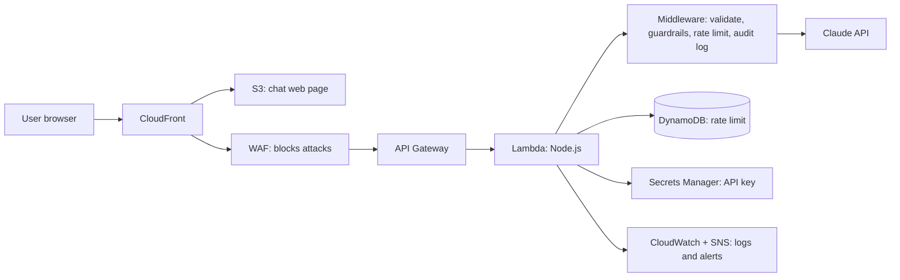

# nt_chatbot
Secure serverless AI chatbot on AWS powered by Claude, deployed with Terraform: guardrails, rate limiting, monitoring and CI/CD.

# nt_Chatbot: Secure Serverless AI Chatbot on AWS

## The problem
Businesses want AI chatbots on their websites, but a chatbot must be **safe** (no leaking personal data, no harmful answers), **cost-efficient** (pay only when used) and **reliable**. This project builds a production-style chatbot that meets all three.

## How it works
User → CloudFront → WAF → API Gateway → Lambda → Claude (Anthropic)

| Tool / Service | What it does | Why I chose it |
|---|---|---|
| Claude (Anthropic API) | Generates the answers | _to fill in_ |
| AWS Lambda | Runs the chatbot logic only when a question arrives | _to fill in_ |
| API Gateway | Receives requests from the web page | _to fill in_ |
| CloudFront + S3 | Hosts and delivers the chat page | _to fill in_ |
| AWS WAF | Blocks malicious traffic | _to fill in_ |
| DynamoDB | Tracks usage for rate limiting | _to fill in_ |
| Secrets Manager | Stores the API key securely | _to fill in_ |
| CloudWatch + SNS | Logs, alarms and email alerts | _to fill in_ |
| Terraform | Builds all AWS resources as code | _to fill in_ |

## Key features
- Personal data (PII) redaction before messages reach the AI
- Blocking of harmful content and prompt-injection attempts
- Rate limiting per user
- Monitoring and alerts
- Infrastructure as code, with easy teardown to avoid costs

## Progress
- [x] Prerequisites installed
- [x] AWS CLI connected to my account
- [x] Lab code added to my repo
- [ ] One-time setup (bootstrap)
- [ ] Deploy
- [ ] Testing
- [ ] Monitoring
- [ ] CI/CD
- [ ] Cleanup

## Problems log
| # | Problem | Cause | Fix I chose | Why |
|---|---|---|---|---|
| 1 | Ubuntu suggested an old AWS CLI (v1 via snap) | Ubuntu's packages lag behind | Installed AWS CLI v2 with Amazon's official installer | The lab needs v2, and the official source is up to date |
| 2 | Ubuntu's Node.js is too old (lab needs 22+) | apt ships an older version | Installed Node LTS with nvm | nvm installs any version without sudo and makes upgrades easy |
| 3 | "Authentication failed" signing in to AWS | Used my email (root login) instead of my IAM username | Signed in through the account's IAM sign-in page with my username | Root is for emergencies only. Daily work uses the IAM user with MFA |
| 4 | Wanted nt_chatbot as the AWS name | S3 bucket names don't allow underscores | Used nt-chatbot (hyphen) for AWS, kept nt_chatbot for the repo | Each system has its own naming rules |
| 5 | CI check "Terraform Validate" failed after a README push: runtime nodejs24.x not allowed | main.tf pinned the AWS provider to "~> 5.0", an older version that doesn't know Node.js 24 | Changed it to "~> 6.0" (installed v6.72.0), ran terraform validate locally, committed main.tf and the lock file | Keeps the modern runtime (Node.js 22 retires sooner). The lock file makes GitHub use the same versions as my PC |

## What I learned
|x| Lesson learned: apostrophes in button messages can break the page | Each starter button's message sits inside single quotes, e.g. sendStarter('...'). An apostrophe like "won't" ends the quote early, so the button fails | Wrote "will not" instead of "won't" (no apostrophes) in all button messages | Avoids a hidden JavaScript error. The page looks fine, but the button silently does nothing when clicked |

## Architecture

## Chat page screenshot

